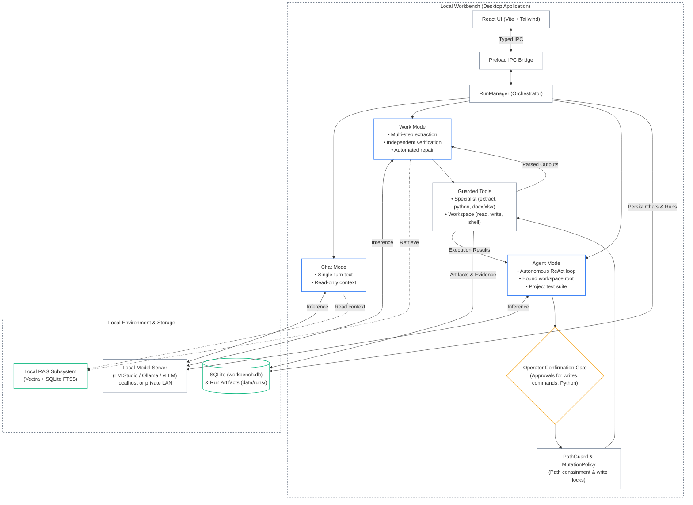

# Local Workbench

Local Workbench is a local-first desktop app for asking questions about files, creating work products, and making approved changes in a selected workspace.

## Project team

| Team | Team ID |
| --- | ---: |
| **Unpaid_Interns** | **119100** |

[](docs/diagrams/00_ARCHITECTURE_AUDIT.md)
[](VERSION)
[](LICENSE)

## What it does

The app connects to a model server running on your computer or private network—no cloud model subscriptions required. Configure model endpoints during initial onboarding.

### Execution Modes

| Mode | Purpose | Capabilities & Boundary |
| --- | --- | --- |
| **Chat** | Questions, document Q&A, and follow-ups | Authorized attachments, previous results, and enabled knowledge sources. No workspace mutation or execution tools. |
| **Work** | Analysis, code repair, and file deliverables | Scoped run storage with input/output isolation. Artifacts undergo independent mechanical and semantic verification before delivery. |
| **Agent** | Autonomous engineering in a bound workspace root | Workspace tools with path confinement, approval gates, mutation logging, automatic backups, and project test verification. |

### Network & Model Port Rules
- **Local / Private Only:** Accepts `localhost`, loopback (`127.0.0.1`), private IPv4 (`10.0.0.0/8`, `172.16.0.0/12`, `192.168.0.0/16`), and local IPv6. Public IP addresses and public domains are strictly rejected.
- **Model Roles:** Supports separate endpoints for **Primary/Coding**, **Vision**, **Draft**, and **Embeddings**. Duplicate endpoints are consolidated in the UI.

---

## Architecture Overview



- **Interactive Context Mentions:** Type `@` in the prompt input to attach workspace files (copies byte snapshots) or reference workspace directories.
- **Adaptive Layout:** Responsive panels featuring collapsible drawer overlays below 1280px (Settings) and 960px (Explorer).
- **In-Depth Technical Reference:** See [AGENTS.md](AGENTS.md) for detailed module contracts, IPC definitions, and storage lifecycles; see [`docs/diagrams/`](docs/diagrams/) for component, data flow, and security boundary diagrams.

---

## Benchmarks (M4 Mac Mini)

End-to-end evaluation metrics measured on an **Apple M4 Mac Mini** (Apple Silicon, 16GB Unified Memory) using a local model server (LM Studio / MLX):

- **7B Multi-Model:** `qwen2.5-coder-7b-instruct-mlx` (Text / Code) + `qwen/qwen3-vl-4b` (Vision) + `text-embedding-nomic-embed-text-v1.5` (Embeddings)
- **9B Unified:** `qwen/qwen3.5-9b` (Unified Multimodal) + `text-embedding-nomic-embed-text-v1.5` (Embeddings)

| Task / Scenario | 7B (Non Thinking)  | 9B (Thinking) | Verification Pass Rate |
| :--- | :---: | :---: | :---: |
| Sensor log CSV parser bug repair & CLI execution validation |     **76.0s** | **122.9s** | **100%** (12/12 checks) |
| Pump skid SVG visual inspection & Piping SOP RAG compliance |     **64.3s** | **89.0s** | **100%** (4/4 checks) |

---

## Setup for Development

### Prerequisites
- **Node.js:** 22.12 or later
- **npm:** 10 or later
- **Local Model Server:** LM Studio, Ollama, vLLM, or `llama-server` (running and reachable at `http://localhost:<port>/v1`)

### Quickstart Commands
```bash
# 1. Install dependencies
npm ci

# 2. Start renderer and Electron in dev mode
npm run dev
```

### Verification & Testing
```bash
# Type checking
npm run typecheck

# Unit & integration test suites
npm test

# Build production bundles
npm run build

# Behavioral CLI test worker bundle rebuild
npm run build:behavioral

# Interactive Chat UX harness (macOS/Linux)
env -u ELECTRON_RUN_AS_NODE node_modules/.bin/electron scripts/test-chat-ux.cjs
```

### Desktop Packaging
```bash
# Build native installer / package for the current host OS
npm run package

# Build unpacked package directory for inspection
npm run package:dir
```

- **Packaging Targets:**
  - **macOS:** DMG (`.dmg`) and App bundle (`.app`) with custom Finder icon metadata.
  - **Windows:** NSIS x64 installer (`.exe`).
  - **Linux:** AppImage (`.AppImage`).
- **Development Reset on Packaging:**
  - `npm run package` runs `scripts/reset-dev-defaults.cjs` to clear development database settings and reset `config/models.json`.
  - Development chats, runs, and knowledge indexes are retained; release packages always start with clean, unconfigured state.

### App Icons
- Source asset: `icon.png` in project root.
- Generator: `npm run build:icons`
- Artifacts:
  - macOS: `build/icons/icon.icns` (and Finder bundle icon via Swift script)
  - Windows: `build/icons/icon.ico`
  - Linux: `build/icons/icon.png`

### Storage Isolation
- **Development:** Uses `data/` directly within the repository root.
- **Preview:** Isolated under `<appData>/local-workbench/preview/`.
- **Production / Release:** Isolated under `<appData>/local-workbench/production/`.
- **System AppData Paths:**
  - **macOS:** `~/Library/Application Support/`
  - **Windows:** `%APPDATA%/`
  - **Linux:** `$XDG_CONFIG_HOME/` or `~/.config/`

---

## Execution Support by Platform

The application probes host capabilities dynamically. Service status is visible in the status bar and Settings panel.

| Platform | Agent Workspace Commands | Python in Run Storage |
| --- | --- | --- |
| **macOS** | Uses `sandbox-exec` when probe passes. Otherwise `/bin/sh` with operator approval. | Uses `sandbox-exec` when probe passes. Otherwise approved fallback with digest binding. |
| **Linux** | Uses Bubblewrap (`bwrap`) when probe passes. Otherwise `/bin/sh` with operator approval. | Uses Bubblewrap when probe passes. Otherwise approved fallback with digest binding. |
| **Windows** | Uses `cmd.exe` with operator approval (no native OS sandbox backend). | Python 3 required. Execution requires approval (no OS filesystem or network isolation). |

### Isolation & Execution Details
- **Linux Bubblewrap (`bwrap`):**
  - Probes `/usr/bin/bwrap`, `/bin/bwrap`, and system `PATH`.
  - Requires kernel unprivileged user namespace support (`kernel.unprivileged_userns_clone=1`).
  - If unprivileged namespaces are disabled, execution falls back to explicit approval with user permissions.
- **Python Discovery:**
  - Discovers interpreter via `PYTHON` environment variable, then `PATH` (`python3`, `python.exe`).
  - Launches in an isolated environment excluding user-level site packages.
- **Approved Fallback Security:**
  - When OS sandbox isolation is unavailable, operator approval binds the exact run, source digest, dependencies, and input digests.
  - Any post-approval change invalidates authority and triggers a new confirmation request.
  - Fallback mode runs with current user permissions; it does not enforce kernel-level network or filesystem fences.
- **Workspace Containment:**
  - Agent commands run inside an isolated workspace snapshot.
  - File changes are verified against permitted paths, rejecting symlinks and path traversals before publishing with backups.
- **Filesystem & Manifest Sync:**
  - Windows syncs published files with writable handles; Unix systems sync files and parent directories.
  - SQLite manifests record immutable result IDs, file digests, and execution scopes.

---

## Safety Notes

- **Read-Only Chat & Work:** Neither Chat nor Work mode has access to workspace mutation tools.
- **Scoped Agent Authority:** Agent operations are restricted to the selected workspace root with explicit approval modals for file writes and shell commands.
- **Path Guard:** Rejects path escapes (`..`), absolute path injection, and symlink targets outside the workspace.
- **Isolated Artifacts:** Generated deliverables are written to run-scoped storage (`data/runs/<runId>/output/`) and require explicit user action to export to the host filesystem.

---

## Example Workflows

The [`demo/`](demo/) folder contains sample scenarios and evaluation fixtures:
- `demo/flow_a/`: Multi-page equipment inspection reports and Word note drafting.
- `demo/flow_b/`: Broken CSV vendor log parser repair and boundary condition testing.
- `demo/flow_c/`: Pump skid SVG drawing review against piping engineering standards.

---

## Releases & License

- Published release binaries and platform release notes: [GitHub Releases](https://github.com/BITverse-24/agent/releases).
- License: [MIT License](LICENSE).
