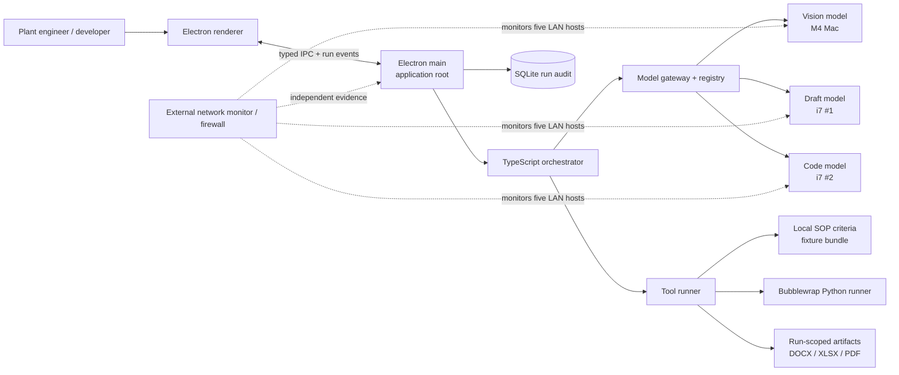

# Sovereign Workbench MVP Architecture

This is the architecture entry point for the SIH 2026 MVP. It describes a
single-user, offline demonstration system, not a production enterprise
platform. Read the linked documents in this order:

1. [Components and contracts](components-and-contracts.md)
2. [Flows and data](flows-and-data.md)
3. [Deployment and sovereignty](deployment-and-sovereignty.md)
4. [Delivery and verification](delivery-and-verification.md)

## Architecture goals

- Demonstrate automatic routing across vision, drafting, and coding models.
- Produce an evidence-grounded approval-readiness decision packet `.docx` and
  preview PDF from a scanned report, including SOP citations.
- Generate and verify a Python solution in a network-isolated execution
  environment.
- Keep all inference, local criteria, artifacts, and audit data on the LAN.
- Keep the implementation small enough for a 12-day, three-person build.

## System boundary

`Electron main` is the application's single root component and privileged
integration boundary. It starts the application, owns all IPC, composes the
orchestrator modules, owns local persistence, and is the only component that
may reach LAN model services or run local tools. The renderer is untrusted
presentation code: it never receives model-service addresses, filesystem
paths, or tool capabilities.



The external network monitor/firewall is deployment infrastructure, not an
application feature. The MVP neither implements it nor treats its data as an
application source of truth. The finals demo operator uses it as independent
evidence that only the named LAN hosts exchanged traffic.

## Deliberate MVP limits

- The governing SOP criteria are a small prepared local fixture set, not an
  enterprise-scale knowledge repository.
- Only two rehearsed flows are in the acceptance bar. Presenters use fixed,
  pre-tested local files through the real file-drop interaction.
- Python is the only executable language. There is no multi-user support,
  authentication, PowerPoint generation, broad handwriting OCR, or general
  enterprise security hardening.
- A bounded tool-calling agent is used instead of an unrestricted autonomous
  agent. The runtime validates every tool request, limits steps, and stops on
  invalid output or unavailable dependencies.

## Component ownership

| Owner | Primary responsibility | Explicit boundary |
| --- | --- | --- |
| Ayush (frontend) | Electron renderer, file drop, transcript, confirmations, routing badge, PDF pane | No direct filesystem, model, tool, or LAN access |
| Supreet (backend) | Electron main composition, IPC, orchestrator, registry gateway, tools, SQLite, artifacts | Does not build the external monitor or model runtimes |
| Sid (AI/ML) | Offline model provisioning, performance checks, OCR, drawing, and prompt evaluation | Does not add unsupported task categories |

## Module composition

The implementation should have one top-level process entry point:

```text
apps/desktop/src/main/index.ts              Electron main root
  ├─ ipc/registerHandlers.ts                typed renderer boundary
  ├─ orchestration/runOrchestrator.ts       run state machine + agent loop
  ├─ models/modelGateway.ts                 registry lookup + OpenAI-style calls
  ├─ tools/toolRunner.ts                    policy enforcement + tool dispatch
  ├─ persistence/runRepository.ts           SQLite audit/run state
  └─ artifacts/artifactService.ts           run workspace + DOCX/PDF handling
```

These are modules imported by Electron main, not independently deployed
application services. Model servers are the only LAN services required by the
MVP; Flow A criteria are bundled locally with the fixed demo fixtures.

## Non-negotiable operational rules

1. All model weights, application dependencies, local criteria, and demo files
   are installed before the air-gapped rehearsal.
2. The registry shipped in the demo bundle contains only approved LAN IP
   addresses and ports. A development registry may point at the team's
   approved OpenRouter account; it is never used in rehearsals or the finals
   bundle.
3. Each run has an isolated local workspace; input is preserved read-only and
   outputs are written only below that run directory.
4. DOCX/XLSX writes and Python execution require an explicit renderer
   confirmation. The confirmation action is recorded in SQLite.
5. A failed health check, invalid model output, schema failure, or tool timeout
   produces a visible run failure; it must never silently fall back to an
   internet service.
