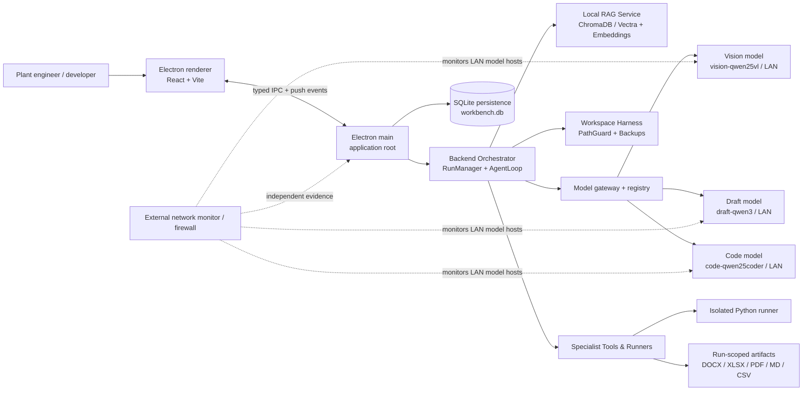

# Sovereign Workbench MVP Architecture

This is the architecture entry point for the SIH 2026 MVP. It describes a
single-user, offline demonstration system, not a production enterprise
platform. Read the linked documents in this order:

1. [Components and contracts](components-and-contracts.md)
2. [Flows and data](flows-and-data.md)
3. [Deployment and sovereignty](deployment-and-sovereignty.md)
4. [Delivery and verification](delivery-and-verification.md)

## Architecture goals

- Demonstrate automatic routing across multimodal vision, drafting/reasoning, and coding models.
- Produce an evidence-grounded approval-readiness decision packet `.docx` and preview PDF from scanned engineering reports, including SOP citations.
- Inspect and audit engineering drawings (SVG/PDF) against governing specifications retrieved dynamically via local RAG (ChromaDB / Vectra).
- Provide a secure, path-contained project workspace harness (`list_dir`, `read_file`, `write_file`, `delete_file`, `search`, `run_command`) with automatic backup snapshots.
- Generate, repair, and verify Python solutions in an air-gapped, network-isolated execution sandbox with bounded iteration and self-correction.
- Keep all inference, local criteria, artifacts, and audit data strictly on the LAN or local host with zero external egress.

## System boundary

`Electron main` is the application's single root component and privileged integration boundary. It initializes the desktop lifecycle, owns all IPC channels, manages local SQLite persistence, provisions the workspace harness, and controls model execution. The renderer is untrusted presentation code: it never receives raw model-service addresses, direct filesystem handles, or arbitrary tool capabilities, communicating strictly through the typed `window.workbenchBridge` preload interface.



The external network monitor/firewall is deployment infrastructure, not an application feature. The MVP neither implements it nor treats its data as an application source of truth. The finals demo operator uses it as independent evidence that only the approved LAN hosts exchanged traffic.

## Deliberate MVP limits

- The governing SOP criteria and technical standards are indexed into local vector storage (ChromaDB / Vectra) for dynamic retrieval-augmented generation.
- Three canonical rehearsed flows (Flow A: Scanned inspection bundle, Flow B: Vendor log parser sandbox repair, Flow C: Engineering drawing audit) represent the benchmark acceptance bar.
- Python is the primary sandboxed execution language, augmented with native TypeScript/JS tool execution and workspace manipulation.
- A bounded, native tool-calling unified agent loop (`AgentLoop`) validates every tool request, enforces upfront plan confirmation gates for destructive actions or file modifications, and limits steps to prevent runaway execution.

## Component ownership

| Owner | Primary responsibility | Explicit boundary |
| --- | --- | --- |
| Ayush (frontend) | Electron renderer, file drop, unified transcript, confirmations, routing telemetry badge, PDF pane, Knowledge Base & Onboarding UI | No direct filesystem, model, tool, or LAN access |
| Supreet (backend) | Electron main composition, IPC handlers, RunManager, AgentLoop, ToolDispatcher, HarnessManager, ModelGateway, SQLite persistence, RAG service, artifact workers | Does not build the external monitor or model runtimes |
| Sid (AI/ML) | Offline model provisioning, performance checks, OCR/vision evaluation, drawing analysis, prompt engineering, local embeddings & chunking | Does not add unsupported task categories |

## Module composition

The application implementation is structured into modular layers rooted at Electron main and the backend runtime:

```text
electron/
  ├── main.ts                               Electron main root (window lifecycle, Vite spawner, IPC init)
  └── preload.ts                            Secure contextBridge exposing window.workbenchBridge

backend/src/main/
  ├── index.ts                              initBackend() entry point
  ├── ipc/
  │   ├── channels.ts                       Typed IPC channel constants
  │   └── handlers.ts                       IPC dispatch (chat, run, workspace, KB, onboarding)
  ├── run/
  │   ├── manager.ts                        RunManager lifecycle, attachment staging, continuations
  │   ├── store.ts                          SQLite run state transitions & audit log
  │   └── filesystem.ts                     Run directory layout (data/runs/<runId>/...)
  ├── agent/
  │   ├── agent-loop.ts                     Unified multi-turn tool-calling loop (v2 architecture)
  │   ├── tool-dispatcher.ts                Concurrent tool execution via Promise.all()
  │   ├── context-manager.ts                Sliding-window context compaction
  │   └── code-extractor.ts                 Script and markdown artifact parsing
  ├── harness/
  │   ├── harness-manager.ts                Workspace root management & tree notifications
  │   ├── path-guard.ts                     Strict directory containment (resolveSafe)
  │   └── tools/                            Workspace tools (list_dir, read_file, search, write_file, delete_file, run_command)
  ├── gateway/
  │   ├── model-gateway.ts                  OpenAI-compatible HTTP client & normalizer
  │   └── registry.ts                       Model registry loader & health checks
  ├── router/
  │   ├── contextual-router.ts              Semantic intent resolution & file target matching
  │   ├── driver-router.ts                  Lead model selection (code vs draft vs vision)
  │   ├── deterministic-router.ts           Deterministic rule fallback routing
  │   └── tool-compositor.ts                Environment-aware tool surface composition
  ├── grounding/
  │   ├── rag-grounding-provider.ts         RAG grounding retrieval adapter
  │   ├── sop114-engine.ts                  Rule evaluation for pressure equipment inspections
  │   └── spec-compliance.ts                Drawing specification compliance evaluation
  ├── rag/
  │   ├── rag-service.ts                    Local vector store management & queries
  │   ├── chunker.ts                        Clause and paragraph chunking
  │   └── embedding.ts                      Local embedding generation
  ├── tools/
  │   ├── specialist-tools.ts               extract_document, generate_code, generate_text, retrieve_knowledge, execute_python, generate_deliverable
  │   ├── workspace-tools.ts                Harness tools exposed to the agent loop
  │   ├── python.ts                         Air-gapped Python runner
  │   ├── artifacts.ts                      Native DOCX, XLSX, and Markdown generators
  │   └── document-reader.ts                Native PDF (pdfjs-dist) & DOCX text extraction
  └── persistence/
      ├── db.ts                             better-sqlite3 initialization with WAL mode
      ├── schema.sql                        Relational schema for runs, chats, messages, artifacts
      ├── chats.ts / messages.ts            Chat and message stores
      └── settings-store.ts                 Persisted workspace and model settings
```

## Non-negotiable operational rules

1. All model weights, application dependencies, local criteria, and demo files are installed before the air-gapped rehearsal.
2. The registry shipped in the demo bundle contains only approved LAN IP addresses and ports. A development registry may point at an approved OpenRouter account during dev; it is never used in rehearsals or finals.
3. Each run has an isolated local workspace under `data/runs/<runId>/`; inputs are preserved read-only and outputs are isolated.
4. Consequential actions (destructive shell commands, official file creation, script execution) are subject to plan confirmation gates or safety checks. All actions and approvals are recorded in SQLite.
5. A failed health check, invalid model output, schema failure, or tool timeout produces a visible run failure; it must never silently fall back to an unauthorized external internet service.
6. **Zero hardcoded fixture data**: All extractions, compliance findings, code repairs, and document deliverables must be dynamically computed by models and tools from actual runtime files, never hardcoded or pre-scripted.
