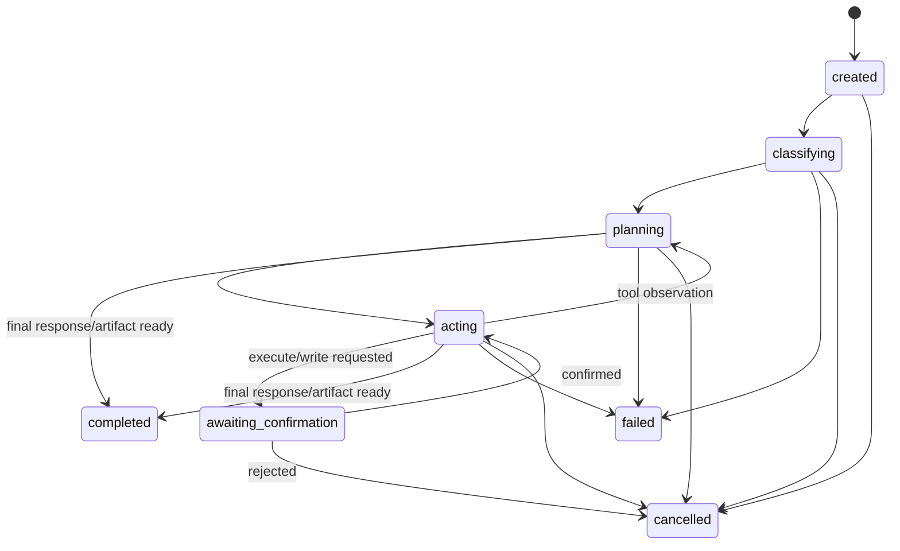

# Components and Contracts

## Runtime state model

A run is a finite state machine. Only Electron main may transition its state;
the renderer receives events and requests confirmations through IPC.



The run has a hard limit of eight model/tool iterations. Demo scenarios may
exercise vision extraction, knowledge search, drafting, code execution, or
spreadsheet generation, but the orchestrator is capability-driven rather than
Flow A/Flow B-specific. Exceeding the limit fails the run with a visible
reason.

### Model registry

`config/models.json` is the model-selection configuration. In addition, users can configure custom local LAN endpoints dynamically via the desktop onboarding wizard (persisted in SQLite settings).

```ts
type TaskType = "vision" | "draft" | "code" | "plan";
type ModelRuntime = "mlx-lm" | "llama-server" | "ollama";
type ModelId = "vision-qwen25vl" | "draft-qwen3" | "code-qwen25coder" | "plan-qwen3-8b";

interface ModelRegistryEntry {
  id: ModelId;
  taskTypes: TaskType[];
  runtime: ModelRuntime;
  baseUrl: string;                 // approved local/LAN /v1 endpoint
  model: string;                   // local server alias or Ollama tag
  capabilities: ModelCapability[];
  requestTimeoutMs: number;
  healthPath: "/models";
  apiKeyEnv?: string;              // env var NAME holding the key; never the key value
  enabled: boolean;
  maxOutputTokens?: number;
}
```

The offline deployment points strictly to local or private LAN endpoints (such as `mlx-lm`, `llama-server`, or Ollama).


| Route / Role | Target Model | Runtime / Protocol | Purpose |
| --- | --- | --- | --- |
| `vision` | Qwen2.5-VL-3B-Instruct / Qwen3-VL-32B | MLX / Ollama / OpenAI-compatible `/v1` | Multimodal scanned PDF/image analysis, handwriting & drawing inspection |
| `draft` | Qwen3-4B-Instruct / Qwen3-8B | llama-server / Ollama / `/v1` | Technical reasoning, grounding synthesis, and formal note drafting |
| `code` | Qwen2.5-Coder-7B / Qwen3-Coder | llama-server / Ollama / `/v1` | Software analysis, Python generation, and automated sandbox self-repair |
| `plan` | Qwen3-8B-Instruct | llama-server / Ollama / `/v1` | High-level decomposition of complex multi-step workflows |
| `embedding`| Local embedding model / BGE | Ollama / Vectra / ChromaDB | Local vector embeddings for SOP clauses and technical standards |

## Router and agent policy (v2 Architecture)

Sovereign Workbench v2 employs a **Unified Agent Execution Loop** (`AgentLoop`) with native tool calling (`tools` array with `tool_choice: "auto"`):

1. **Semantic Intent Resolution**: Analyzes user prompt, attachments, and mounted workspace files to determine modality (`TaskType`), driver model (`draft-qwen3` vs `code-qwen25coder`), and execution focus.
2. **Environment-Aware Tool Surface Composition**: `composeTools` dynamically scopes the available tool definitions based on active runtime capabilities:
   - If a workspace is mounted: registers `list_dir`, `read_file`, `write_file`, `delete_file`, `search`, and `run_command`.
   - If user attachments or multimodal documents exist: registers `extract_document`.
   - If knowledge base documents are indexed: registers `retrieve_knowledge`.
   - Specialist capabilities: registers `generate_code`, `generate_text`, `execute_python`, and `generate_deliverable`.
3. **Upfront Plan Review & Confirmation Gate**: If the driver model invokes tools on turn 1, the execution pauses for user confirmation of the proposed plan and initial tool calls.
4. **Concurrent Tool Dispatch**: Independent tool calls are executed concurrently using `Promise.all()`.
5. **Context Compaction**: Context older than 2 turns is compacted using sliding-window summarization to protect local model context windows.

## Electron IPC contract

The preload bridge (`electron/preload.ts`) exposes typed namespaces via `window.workbenchBridge` (and aliases `window.workbench`):

```ts
interface WorkbenchBridge {
  // Chat persistence
  createChat(input?: { title?: string }): Promise<{ chatId: string }>;
  getChatHistory(input?: { limit?: number }): Promise<{ chats: ChatSummary[] }>;
  archiveChat(chatId: string): Promise<void>;
  getMessages(chatId: string): Promise<{ messages: PersistedMessage[] }>;
  sendMessage(chatId: string, role: "user" | "assistant", content: string, attachmentIds?: string[]): Promise<{ messageId: string; seq: number }>;
  editMessage(messageId: string, content: string): Promise<void>;
  renameChat(chatId: string, title: string): Promise<void>;
  getSetting(key: string): Promise<{ value: unknown }>;
  setSetting(key: string, value: unknown): Promise<void>;

  // Run protocol
  startRun(input: {
    userText: string;
    attachmentToken?: string;
    attachmentTokens?: string[];
    runId?: string;
    chatId?: string;
    temperature?: number;
    groundingEnabled?: boolean;
    preferredRoute?: string;
  }): Promise<{ runId: string }>;
  registerAttachment(input: {
    chatId?: string;
    filename: string;
    mediaType: string;
    sizeBytes: number;
    base64OrBuffer: string;
  }): Promise<{ runId: string; attachment: AttachmentReference }>;
  confirmAction(input: { runId: string; actionId: string; approved: boolean }): Promise<void>;
  cancelRun(input: { runId: string }): Promise<void>;
  getRunHistory(input?: { limit?: number }): Promise<RunSummary[]>;
  getArtifact(input: { runId: string; artifactId: string }): Promise<ArtifactRef>;
  openArtifact(input: { runId: string; artifactId: string }): Promise<{ opened: true; filename: string }>;
  saveArtifact(input: { runId: string; artifactId: string }): Promise<{ saved: boolean; filename?: string }>;
  copyArtifact(input: { runId: string; artifactId: string }): Promise<{ copied: boolean; mode: "text" | "file"; filename: string }>;
  getHealth(): Promise<ModelHealth[]>;
  getRunLogs(input: { runId: string; limit?: number }): Promise<{ runId: string; entries: unknown[]; files: string[]; recentFull: unknown }>;
  getRunLogFile(input: { runId: string; filename: string }): Promise<{ runId: string; filename: string; content: unknown }>;
  onRunEvent(listener: (event: RunEvent) => void): () => void;

  // Knowledge base (SOP RAG)
  kbListDocs(): Promise<DocumentRecord[]>;
  kbIngestDoc(input: { doc_id: string; title: string; source_path: string; doc_type?: string; department?: string; effective_date?: string; page_count?: number; ocr_used?: boolean }): Promise<{ ok: boolean; docId: string; chunkCount: number }>;
  kbDeleteDoc(docId: string): Promise<{ ok: boolean; docId: string }>;
  kbReindex(docId?: string): Promise<{ ok: boolean; chunksIndexed: number }>;
  kbQuery(text: string, topK?: number): Promise<{ ok: boolean; results: RetrievalResult[] }>;
  kbStats(): Promise<RAGStats>;

  // Workspace harness
  pickWorkspaceFolder(): Promise<string | null>;
  registerWorkspace(dirPath: string): Promise<WorkspaceInfo>;
  deregisterWorkspace(): Promise<{ ok: boolean }>;
  getCurrentWorkspace(): Promise<WorkspaceInfo | null>;
  listWorkspaceDir(path?: string): Promise<{ tool: "list_dir"; result: HarnessDirEntry[] }>;
  readWorkspaceFile(path: string): Promise<{ tool: "read_file"; result: string }>;
  searchWorkspace(query: string, path?: string): Promise<{ tool: "search"; result: HarnessSearchMatch[] }>;
  writeWorkspaceFile(path: string, content: string): Promise<{ tool: "write_file"; result: HarnessWriteResult }>;
  runWorkspaceCommand(command: string): Promise<{ tool: "run_command"; result: HarnessCommandResult }>;
  onWorkspaceEvent(listener: (event: unknown) => void): () => void;

  // Onboarding & model configuration
  getOnboardingStatus(): Promise<OnboardingStatus>;
  saveModelConfig(models: ModelConfigRow[]): Promise<{ ok: boolean }>;
  testModelEndpoint(input: { host: string; port: number; modelName?: string; role?: string }): Promise<ModelEndpointTestResult>;
  resetOnboarding(): Promise<{ ok: boolean }>;
}

```

```ts
type RunEvent =
  | { type: "run_state"; runId: string; state: RunState }
  | { type: "routing"; runId: string; taskType: TaskType; modelId: ModelId; reason: string; tier?: "text" | "vision"; tokensSaved?: number; providerEndpoint?: string }
  | { type: "plan_step"; runId: string; index: number; text: string }
  | { type: "agent_thinking"; runId: string; text: string; turn?: number }
  | { type: "tool_call"; runId: string; tool: ToolName; summary: string; callId?: string; args?: Record<string, unknown> }
  | { type: "tool_result"; runId: string; tool: ToolName; summary: string; callId?: string; output?: string; durationMs?: number }
  | { type: "confirmation_required"; runId: string; action: PendingAction }
  | { type: "artifact_ready"; runId: string; artifact: ArtifactRef }
  | { type: "assistant_message_chunk"; runId: string; messageId: string; delta: string; modelId: ModelId }
  | { type: "assistant_message_reset"; runId: string; messageId: string }
  | { type: "assistant_message"; runId: string; messageId: string; text: string; modelId: ModelId }
  | { type: "error"; runId: string; code: string; message: string; retryable?: boolean }
  | { type: "grounding_context"; runId: string; status: "retrieving" | "injected" | "skipped"; chunkCount?: number; chunks?: GroundingChunk[] };
```

## Tool contracts and execution

Tool definitions adhere to OpenAI function calling specifications (`AgentTool` interface) with schema validation:

| Tool | Category | Input Schema | Output Description | Implementation |
| --- | --- | --- | --- | --- |
| `extract_document` | Specialist | `{ filename, query? }` | Structured findings, page references, source text | Hybrid: native PDF text (`pdfjs-dist`), native DOCX (`docx`), or multimodal vision gateway call |
| `generate_code` | Specialist | `{ spec, language?, filename? }` | Source code and expected result | Code specialist model call (`code-qwen25coder`) |
| `generate_text` | Specialist | `{ prompt, context? }` | Grounded technical report text | Draft specialist model call (`draft-qwen3`) |
| `retrieve_knowledge` | Specialist | `{ query }` | Formatted clauses with citation IDs & section labels | Local ChromaDB / Vectra vector RAG retrieval |
| `execute_python` | Specialist | `{ code, input_files?, filename? }` | Exit code, stdout, stderr, execution duration, output artifact refs | Sandboxed Python process with network isolation (`--unshare-net`) |
| `generate_deliverable` | Specialist | `{ type: "docx"\|"xlsx"\|"md", title?, content, filename? }` | Artifact reference & byte count | Native `docx` library (Word), `exceljs` (Excel), or markdown writer |
| `list_dir` | Workspace | `{ path? }` | Directory tree entries (name, type, size) | Harness listing with depth limit and `.gitignore` filtering |
| `read_file` | Workspace | `{ path }` | File content (text or extracted document) | PathGuard-contained reader (up to 200KB) |
| `write_file` | Workspace | `{ path, content }` | Write confirmation, backup path, unified diff | PathGuard-contained writer with automatic `.harness_backups/` snapshot |
| `delete_file` | Workspace | `{ path }` | Deletion confirmation & backup path | PathGuard-contained file removal with automatic backup |
| `search` | Workspace | `{ query, path? }` | Array of `{ file, lineNumber, matchingLine }` | Fast workspace file search / regex matcher |
| `run_command` | Workspace | `{ command }` | Exit code, stdout, stderr, execution duration | Workspace-scoped child process execution (60s timeout) |

## Persistence architecture

SQLite (`data/workbench.db`) with WAL (Write-Ahead Logging) mode stores:
- **Chats & Messages**: Multi-turn chat sessions, sequence numbers, assistant streaming resets, and attachment links.
- **Runs & State**: Run state machine transitions, routing telemetry (task type, model, tokens saved, reason), and error events.
- **Artifacts**: Immutable metadata for deliverables (`.docx`, `.xlsx`, `.md`, `.csv`, `.pdf`, `.py`), file size, relative paths, and preview text.
- **Knowledge Base Records**: Indexed SOP document entries, clause counts, and chunk records.
- **Settings & Onboarding**: Persisted workspace root, model configurations, dev mode flag, and temperature preferences.

Run workspaces are isolated on disk under `data/runs/<runId>/`:
- `input/`: Staged attachments and read-only source files.
- `intermediate/`: Scratch files, temporary scripts, and raw model outputs.
- `output/`: Final verified deliverables and reports.
- `logs/`: Structured JSONL execution logs and tool transition traces.
