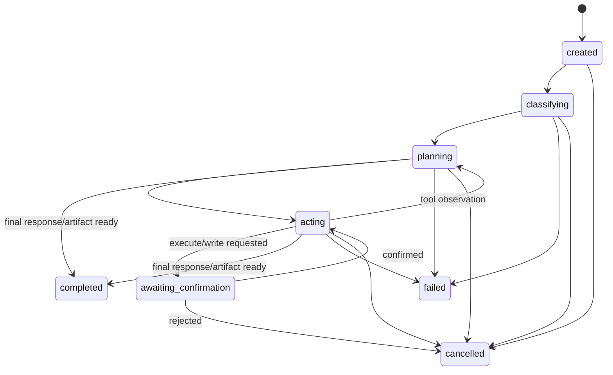

# Components and Contracts

## Runtime state model

A run is a finite state machine. Only Electron main may transition its state;
the renderer receives events and requests confirmations through IPC.



The run has a hard limit of eight model/tool iterations. Flow A normally uses
vision extraction, knowledge search, drafting, and approval-note generation.
Flow B normally uses file inspection, code drafting, Python execution, and
result summarisation. Exceeding the limit fails the run with a visible reason.

## Model registry

`config/models.json` is the sole model-selection configuration. It is checked
into the deployment bundle and edited only before a demo rehearsal. The router
does not construct arbitrary URLs.

```ts
type TaskType = 'vision' | 'draft' | 'code';
type ModelRuntime = 'mlx-lm' | 'llama-server' | 'openrouter';

interface ModelRegistryEntry {
  id: 'vision-qwen25vl' | 'draft-qwen3' | 'code-qwen25coder';
  taskTypes: TaskType[];
  runtime: ModelRuntime;
  baseUrl: string;                 // approved http://LAN_IP:PORT/v1; OpenRouter URL in development
  model: string;                   // local server alias, or OpenRouter model slug in development
  requestTimeoutMs: number;
  healthPath: '/models';
  apiKeyEnv?: string;              // env var NAME holding the key; never the key value
  enabled: boolean;
}
```

During development the working registry may contain OpenRouter entries — one
stand-in model per task type — marked with `runtime: 'openrouter'` and an
`apiKeyEnv` naming the environment variable that holds the key. The key value
never enters the repository, the committed registry, or the renderer. The
registry shipped in the demo bundle is LAN-only: task 11a removes the
OpenRouter entries and re-runs every health check against the local endpoints
before rehearsal.

| Route | Model/runtime | Host | Purpose |
| --- | --- | --- | --- |
| `vision` | Qwen2.5-VL-3B-Instruct, 4-bit MLX via `mlx_lm.server` | M4 Mac Mini | scanned-image/PDF understanding and structured extraction |
| `draft` | Qwen3-4B-Instruct, GGUF Q4 via `llama-server` | i7 #1 | approval-note planning and drafting |
| `code` | Qwen2.5-Coder-7B-Instruct, GGUF Q4 via `llama-server` | i7 #2 | Python task planning, code generation, and output interpretation |

The gateway normalizes all three model services into one internal contract. It
uses OpenAI-compatible `/v1/chat/completions` and `/v1/models` interfaces,
with streaming enabled only when forwarding user-visible draft text. Calls use
fixed endpoint aliases, bounded context, low temperature, and task-specific
system prompts.

## Router and agent policy

Routing is automatic and explainable:

1. An image or a PDF submitted for report analysis selects `vision` first.
2. A request mentioning CSV, calculation, script, code, execution, or data
   transformation selects `code`.
3. All other requests select `draft`.
4. After OCR extraction in Flow A, the orchestrator explicitly switches to
   `draft` and emits a second routing event.

The router is deterministic; the model cannot select an endpoint. The selected
model may propose a tool invocation, but `ToolRunner` checks it against the
current flow's policy, validates its arguments, and applies timeouts before
execution.

| Flow | Allowed automatic tools | Confirmation-required tools |
| --- | --- | --- |
| Inspection report → approval note | `read_file`, `ocr_extract`, `search_knowledge`, `draft_note` | `generate_docx` |
| CSV/code → result | `read_file`, `draft_code` | `execute_python`, `generate_xlsx` |

No tool can create network clients, change registry configuration, access a
path outside its run workspace, or invoke a shell command supplied by the
model.

## Electron IPC contract

The preload bridge exposes only the following typed calls. It does not expose
Electron, Node, filesystem, or raw IPC APIs to the renderer.

```ts
interface WorkbenchBridge {
  startRun(input: StartRunInput): Promise<{ runId: string }>;
  confirmAction(input: ConfirmActionInput): Promise<void>;
  cancelRun(input: { runId: string }): Promise<void>;
  getArtifact(input: { runId: string; artifactId: string }): Promise<ArtifactRef>;
  getRunHistory(input?: { limit?: number }): Promise<RunSummary[]>;
  onRunEvent(listener: (event: RunEvent) => void): () => void;
}
```

`StartRunInput` includes user text and an Electron-issued local attachment
token. It never includes a client-controlled absolute path. `ConfirmActionInput`
includes `runId`, `actionId`, and `approved`; actions expire after five minutes
or when the run is cancelled.

```ts
type RunEvent =
  | { type: 'run_state'; runId: string; state: RunState }
  | { type: 'routing'; runId: string; taskType: TaskType; modelId: string; reason: string }
  | { type: 'plan_step'; runId: string; index: number; text: string }
  | { type: 'tool_call'; runId: string; tool: ToolName; summary: string }
  | { type: 'tool_result'; runId: string; tool: ToolName; summary: string }
  | { type: 'confirmation_required'; runId: string; action: PendingAction }
  | { type: 'artifact_ready'; runId: string; artifact: ArtifactRef }
  | { type: 'error'; runId: string; code: string; message: string };
```

## Tool contracts and persistence

All tool inputs and outputs are Zod-validated in Electron main before storage
or use by the next agent step.

| Tool | Input | Validated output | Local implementation |
| --- | --- | --- | --- |
| `read_file` | attachment token or run-relative path | bounded text/CSV metadata | local reader with type/size allowlist |
| `ocr_extract` | image/PDF attachment | structured findings, page references, source text | vision gateway call |
| `search_knowledge` | query, `topK ≤ 5` | chunks with `documentId`, section, excerpt | local Chroma query |
| `draft_note` | findings and retrieved citations | approval-note body plus cited source IDs | drafting model call |
| `generate_docx` | validated title/body/citations | DOCX and preview-PDF artifact refs | local document worker + LibreOffice |
| `draft_code` | task and input schema | Python source plus expected output description | code model call |
| `execute_python` | generated source and input refs | exit code, capped stdout/stderr, output refs | Bubblewrap runner |
| `generate_xlsx` | validated rows/columns | XLSX artifact ref | local spreadsheet worker |

SQLite stores run metadata, state transitions, routing decisions, pending and
resolved confirmations, event summaries, citations, artifact metadata, and
errors. It does not duplicate large attachments or model prompts. Attachments,
intermediate files, and artifacts live under `data/runs/<run-id>/`.
