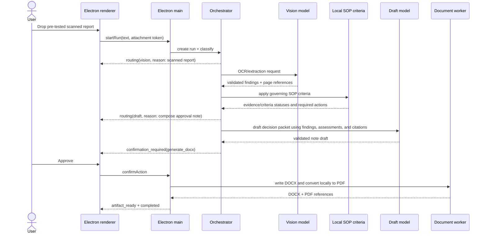
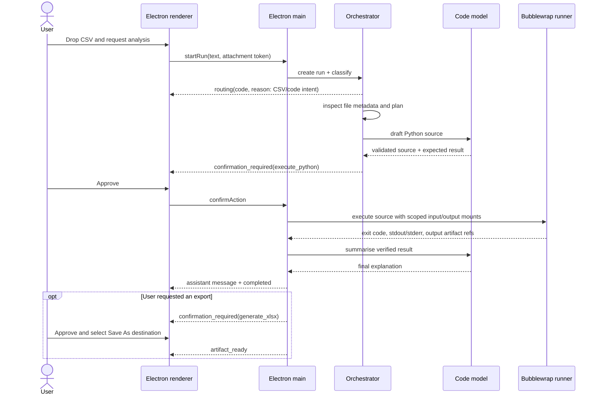

# Flows and Data

## Shared data handling

1. Electron main copies an accepted dropped file into
   `data/runs/<run-id>/input/` and assigns a random attachment token.
2. Tools receive tokens or run-relative paths, never user-provided absolute
   paths.
3. Intermediate OCR text, criteria assessments, draft data, generated code, and
   tool results stay in the same run directory.
4. SQLite records references and audit summaries. Local SOP criteria are
   versioned with the fixture bundle and passed into the assessment step.
5. An artifact is immutable once emitted. PDF previews are derived from the
   generated DOCX, not treated as independently editable documents.

## Flow A — inspection report to approval-readiness decision packet

The assessment and approval-note prompt require citations in the form
`[SOP-114 §3.2]`. The document worker refuses to create a deliverable if a
criterion citation is unsupported. The rendered document includes the
evidence/criteria matrix, explicit `unknown` information, and a short
“Grounding references” section.

OCR output is intentionally limited to clean, typed scans. The UI labels OCR
findings as extracted content, not a claim of handwritten-note accuracy.

## Data-analysis scenario (regression/demo fixture)

The code model never supplies shell arguments. The tool runner writes the
validated Python source to the run workspace and invokes a fixed runner command
with explicit source, input, and output paths. A non-zero exit code is surfaced
as a failed verification, with capped stderr in the transcript; it is never
presented as a successful calculation.

## Required failure behaviour

| Condition | User-visible outcome | Recovery boundary |
| --- | --- | --- |
| Registry endpoint unavailable | run error naming the selected model | retry only after a fresh health check |
| Invalid structured model/tool output | run error with failed validation step | do not guess or call another model |
| Tool not permitted in current flow | run error and audit event | no override from renderer/model |
| Confirmation rejected/expired | cancelled state; no write/execute action | user starts a new run |
| Bubblewrap timeout/non-zero exit | execution failure with bounded logs | user revises request/retries a new run |
| DOCX/PDF conversion failure | DOCX retained; preview failure shown | no fake preview, retry conversion locally |
| Missing governing criteria | assessment fails before document creation | operator repairs the local SOP fixture; no uncited decision packet |
