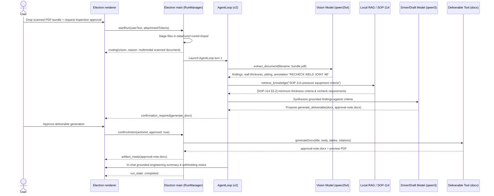
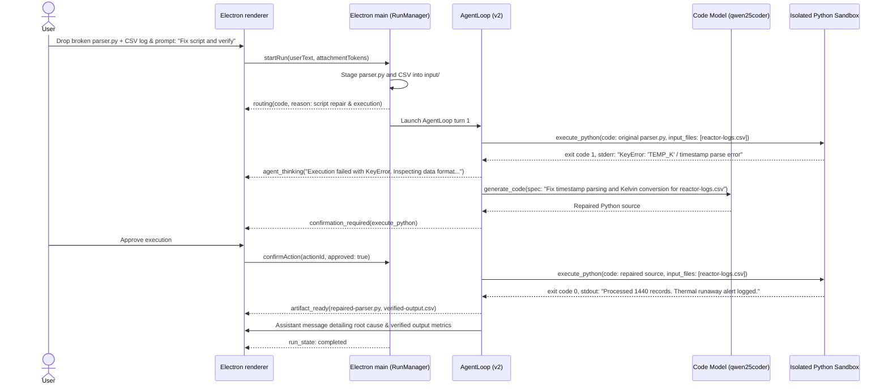

# Flows and Data

## Shared data handling

1. Electron main stages dropped files or attachments into `data/runs/<run-id>/input/` with unique attachment records in SQLite.
2. In multi-turn sessions, prior attachments and generated artifacts in the same chat are retained and staged so follow-up queries or comparative analysis have continuous context.
3. Path containment (`resolveSafe`) guarantees that tools cannot read or mutate files outside the run workspace or registered workspace root.
4. Model tool invocations receive safe relative paths or in-context content sections.
5. Intermediate scripts, model scratchpads, and execution logs reside under `data/runs/<run-id>/intermediate/` and `logs/`.
6. Verified output deliverables (`.docx`, `.xlsx`, `.md`, `.csv`, `.pdf`, `.py`) are stored in `data/runs/<run-id>/output/` and registered as immutable artifacts in SQLite.

---

## Flow A — Scanned inspection bundle to formal approval note (.docx)



- **Grounding standard**: Findings must cite governing clauses (e.g. `[SOP-114 §3.2]`).
- **Safety notice**: If field annotations indicate inspection flags (e.g. *RECHECK WELD JOINT 4B*), the deliverable explicitly withholds unconditional approval, citing required secondary NDT verification.
- **Dynamic generation**: Real numerical measurements, corrosion rates, and observed deviations are extracted directly by the vision model and compiled natively with `docx`.

---

## Flow B — Vendor-log parser repair & sandbox verification (Python Sandbox)



- **Automated self-repair**: The agent observes actual sandbox runtime tracebacks, identifies syntax or column mismatches, and iteratively repairs code without user intervention until verification passes.
- **Network isolation**: The Python runner executes with unshared network namespaces (`--unshare-net`) and 60-second timeouts.

---

## Flow C — Engineering drawing cross-check against piping specification (SVG & RAG)

```mermaid
sequenceDiagram
    actor User
    participant UI as Electron renderer
    participant Main as Electron main (RunManager)
    participant Agent as AgentLoop (v2)
    participant Vision as Vision Model (qwen25vl)
    participant RAG as Local RAG / ChromaDB (SOP-220)
    participant Tool as Deliverable Tool (markdown)

    User->>UI: Drop pump-skid-P204.svg & prompt: "Review drawing against piping spec"
    UI->>Main: startRun(userText, attachmentTokens)
    Main-->>UI: routing(vision, reason: engineering drawing compliance review)
    Main->>Agent: Launch AgentLoop turn 1
    Agent->>Vision: extract_document(filename: pump-skid-P204.svg)
    Vision-->>Agent: Observed: Valve XV-204 (Class 150), Discharge line (DN80)
    Agent->>RAG: retrieve_knowledge("SOP-220 valve rating and line diameter")
    RAG-->>Agent: [SOP-220 §4.2] Min Class 300; [SOP-220 §4.3] Min DN100
    Agent-->>UI: agent_thinking("Detected 2 non-compliances: Class 150 < 300, DN80 < DN100")
    Agent->>Tool: generate_deliverable(type: md, filename: corrective-action-note.md)
    Tool-->>Agent: Created corrective-action-note.md
    Main-->>UI: artifact_ready(corrective-action-note.md)
    Agent->>UI: Compliance review summary table with NON-COMPLIANT badges and required actions
    Main-->>UI: run_state: completed
```

- **Compliance evaluation**: Discrepancies between visual drawing components and governing specifications are surfaced with structured comparison tables.
- **Refusal to sign off**: When non-compliances exist, status is marked `NOT APPROVED (Revisions Required)` and specific engineering corrective actions are mandated.

---

## Required failure behaviour

| Condition | User-visible outcome | Recovery boundary |
| --- | --- | --- |
| Registry endpoint unavailable | Run error naming the selected model and health check status | User verifies local model server port or reconfigures via Onboarding wizard |
| Invalid structured model output | Run error with failed validation step details | Agent loop attempts re-prompt or surfaces clear failure message; does not hallucinate |
| Tool path violation | PermissionError from PathGuard logged in audit | Tool call blocked immediately; workspace containment preserved |
| Confirmation rejected / expired | Cancelled run state; no write or execution occurred | User reviews plan and initiates a revised run |
| Python timeout / nonzero exit | Error traceback captured and fed into agent self-repair loop | Agent attempts up to max repair turns before surfacing bounded failure logs |
| Missing governing SOP criteria | Warning that knowledge base query returned 0 matches | User indexes missing standard via Knowledge Base panel |
