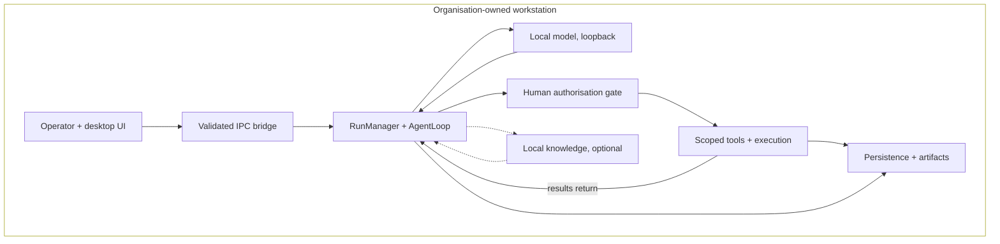

# Candidate A — End-to-End Component Architecture

Balanced general-purpose view: how everything connects inside one organisation-owned workstation.

## What this communicates

Single-workstation story first: everything sits inside one enclosing boundary, with the orchestrator central.
Inference, retrieval, execution, and persistence read as connected subsystems of the agent loop — a system,
not a linear LLM pipeline. Optional paths are dashed so a judge never reads RAG as mandatory.

## Simplifications

- Three registry roles collapsed into one "local model" node; single-endpoint default is the norm
  (`config/models.json`, `model-selection.ts:161ff`).
- Upfront plan gate and per-turn mutation gate merged into one gate node placed **before** guarded execution;
  artifact verification (`verifyArtifactFile`) is implied on the tools-to-persistence edge.
- Technology names (Electron, Node, SQLite) kept out of labels where possible; the slide's left half already names them.
- RAG shown as a conditional side-call, not inline, because the tool is only composed when the KB is non-empty.

## Revisions from review (supersedes v1)

1. Workstation is now an enclosing subgraph, not a node with dashed links.
2. Added `TS --> RM` ("results return") edge: tool observations feed back into the loop — the defining agentic property.
3. Gate moved onto the guarded-action path (`RM --> GATE --> TS`): authorisation precedes consequential execution
   (upfront plan gate + per-turn `policyGuard.isAuthorized` check in `agent-loop.ts`); result verification sits on the
   tools-to-persistence edge. An earlier version placed the gate downstream of tools, implying approval after execution.
4. Persistence is a side branch (`RM --> DB`, `TS --> DB`), not the end of a pipeline.

Physical air-gap remains a deployment condition outside the diagram, not an app-enforced block (see `00 §4`).

## Primary sources

- `electron/main.ts`, `electron/preload.ts`, `backend/src/main/ipc/handlers.ts`
- `backend/src/main/run/manager.ts`, `backend/src/main/agent/agent-loop.ts`
- `backend/src/main/gateway/model-gateway.ts:1479ff`, `config/models.json`
- `backend/src/main/tools/workspace-tools.ts`, `backend/src/main/tools/python.ts`, `backend/src/main/tools/artifacts.ts`
- `backend/src/main/confirmation/store.ts`, `backend/src/main/harness/path-guard.ts`
- `backend/src/main/rag/rag-service.ts`, `ai/rag/db.ts`, `backend/src/main/persistence/db.ts`
