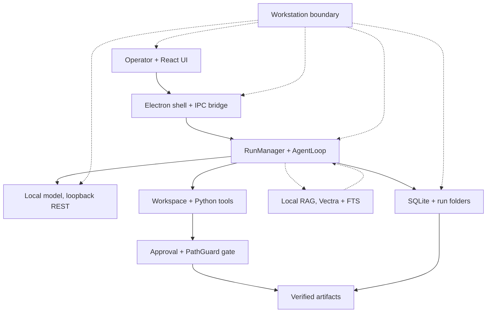

# Candidate A — End-to-End Component Architecture

Balanced general-purpose view: how everything connects inside one organisation-owned workstation.

## What this communicates

Single-workstation story first: operator, desktop shell, orchestrator, loopback model, tools, and local storage
all sit inside one boundary. Optional paths are dashed so a judge never reads multi-model or RAG as mandatory.

## Simplifications

- Three registry roles collapsed into one "local model" node; single-endpoint default is the norm
  (`config/models.json`, `model-selection.ts:161ff`).
- Confirmation + PathGuard merged into one gate node; full upfront vs per-turn distinction lives in Candidate B.
- RAG shown as a conditional side-call, not inline, because the tool is only composed when the KB is non-empty.
- `WS` boundary drawn with dashed links to avoid implying OS enforcement; it is a deployment boundary.

## Primary sources

- `electron/main.ts`, `electron/preload.ts`, `backend/src/main/ipc/handlers.ts`
- `backend/src/main/run/manager.ts`, `backend/src/main/agent/agent-loop.ts`
- `backend/src/main/gateway/model-gateway.ts:1479ff`, `config/models.json`
- `backend/src/main/tools/workspace-tools.ts`, `backend/src/main/tools/python.ts`, `backend/src/main/tools/artifacts.ts`
- `backend/src/main/confirmation/store.ts`, `backend/src/main/harness/path-guard.ts`
- `backend/src/main/rag/rag-service.ts`, `ai/rag/db.ts`, `backend/src/main/persistence/db.ts`
