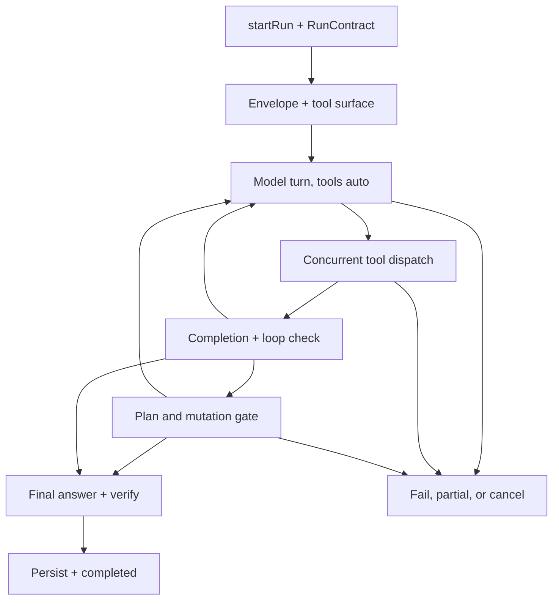

# Candidate B — Agent Execution and Control Flow

What actually happens during a task: the multi-turn loop, tool use, and where a human must approve.

## What this communicates

This is a genuine agentic loop, not a one-shot LLM call: up to 100 turns of model-tool interaction with completion
accounting, loop detection, context compaction, and two distinct authorisation points (upfront plan, per-turn mutation).

## Simplifications

- Streaming, chunk rendering, and per-tool budgeting folded into "model turn" and "dispatch".
- Upfront plan gate and per-turn mutation gate merged into one gate node with a reject edge to terminal states.
- Legacy router branches (`pickDriverModel`, `planner.generatePlan`, regex classifier) omitted; they are unused in V2.
- `limit_exceeded` grouped with fail/partial/cancel to keep the terminal fan readable.

## Primary sources

- `backend/src/main/run/manager.ts` (`start ~399`, `execute ~925`, `confirm ~558`, `awaitConfirmation ~3531`)
- `backend/src/main/agent/agent-loop.ts` (100-turn loop, upfront gate, `~1538` auth check, loop detection)
- `backend/src/main/agent/tool-dispatcher.ts` (`dispatchConcurrent`, `classifyToolError`)
- `backend/src/main/run/contract.ts` (`normalizeRunContract`, `evaluateRunContractCompletion`)
- `backend/src/main/router/tool-compositor.ts`, `backend/src/main/run/envelope.ts`
- `backend/src/main/confirmation/store.ts`, `frontend/src/components/ConfirmationModal.tsx`
