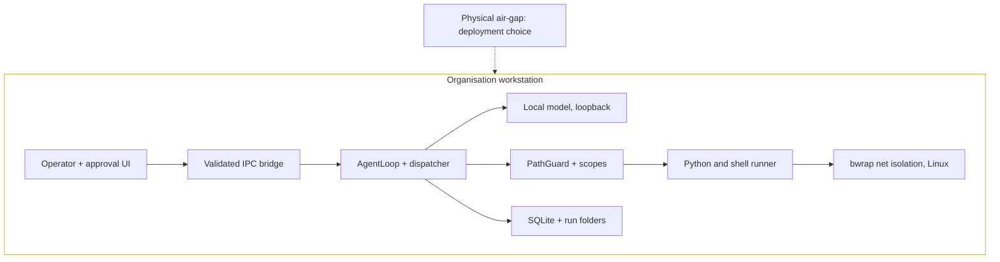

# Candidate C — Single-Workstation Security Boundary

Only enforcement actually found in code. Deployment conditions are labelled as such.

## What this communicates

Defence in depth as implemented: validated IPC, workspace containment, scoped mutation grants with explicit human approval,
verified artifacts, and opportunistic OS isolation — inside a workstation whose physical disconnection is a deployment
choice, not an app firewall. The local model node is declared inside the workstation subgraph (directly under the
agent dispatcher); only the air-gap note sits outside, since disconnection is an operational condition, not a component.

## Simplifications

- macOS `sandbox-exec` opt-in and Windows direct-execution fallback folded into the runner node; Linux `bwrap` called out
  because it is the only OS-enforced network isolation found.
- Direct-UI workspace writes (which bypass explicit scope grants) not shown as a separate edge; covered in `00` audit.
- No firewall, sniffer, crypto-log, or egress-telemetry boxes: none exist in code.

## Primary sources

- `electron/main.ts`, `electron/preload.ts`, `backend/src/main/ipc/validators.ts`
- `backend/src/main/harness/path-guard.ts`, `backend/src/main/harness/policy-guard.ts`
- `backend/src/main/harness/tools/run-command.ts:84-192`, `backend/src/main/tools/python.ts:157-193`
- `backend/src/main/confirmation/store.ts`, `backend/src/main/tools/artifacts.ts`
- `backend/src/main/gateway/model-gateway.ts:918` (`isLocal`), `config/models.json`
