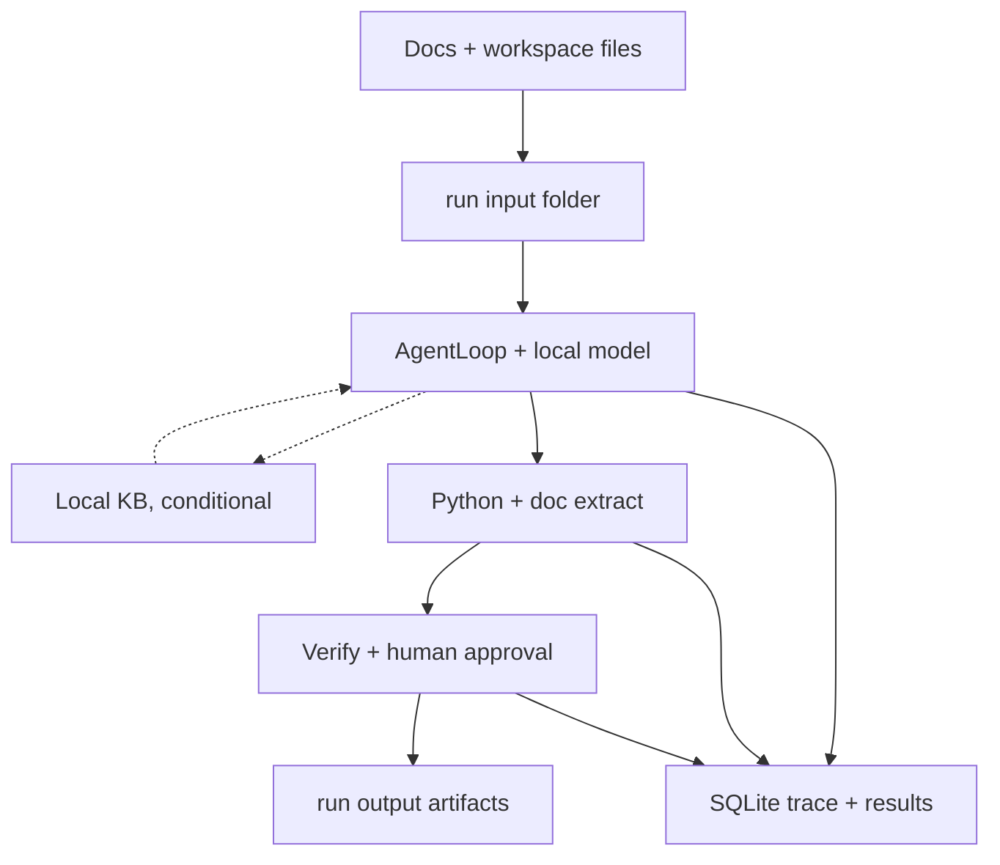

# Candidate D — Data, Evidence and Artifact Flow

How engineering input becomes a useful, reviewable output. Source, intermediate, and final states are visually distinct.

## What this communicates

Provenance chain a judge can follow: originals land in `input/`, only the agent plus bounded tools touch them,
local retrieval is explicitly conditional, nothing becomes final without verification and approval, and every step
leaves a trace in SQLite plus immutable intermediate results.

## Simplifications

- `extract_document`, `execute_python`, and `generate_deliverable` merged into one processing node.
- RunContract routing and envelope gating omitted here (covered in Candidate B).
- Rejected-on-deny and cancel edges omitted; approval node implies the gate.
- Result-store payloads and `retrieve_result` slicing folded into the SQLite trace node.

## Primary sources

- `backend/src/main/run/filesystem.ts` (`input/intermediate/output/logs` layout)
- `backend/src/main/run/manager.ts:440-494` (attachment staging into `input/`)
- `backend/src/main/tools/specialist-tools.ts`, `backend/src/main/tools/python.ts`, `backend/src/main/tools/artifacts.ts`
- `backend/src/main/run/result-store.ts`, `backend/src/main/tools/result-retrieval.ts`
- `backend/src/main/rag/rag-service.ts`, `ai/rag/retrieval.ts`, `backend/src/main/grounding/*`
- `backend/src/main/persistence/schema.sql`, `backend/src/main/run/store.ts`
