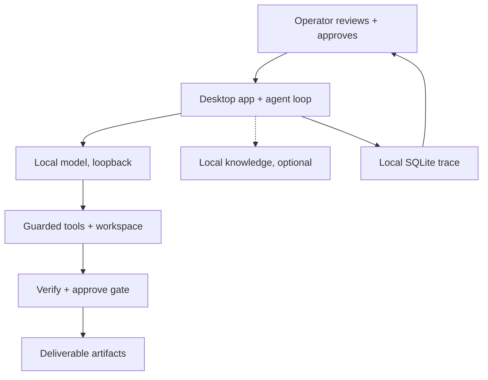

# Candidate E — Minimal High-Clarity Architecture (recommended)

For a judge with ~30 seconds: the fewest nodes that still say something true and distinctive.

## What this communicates

One-workstation loop with the two properties competitors cannot claim by calling a cloud API:
bounded tools that can touch a real workspace, and a human gate plus artifact verification before anything is final —
all over loopback inference with a local trace the operator can re-open.

## Simplifications

- Electron/IPC/RunManager/AgentLoop collapsed into "desktop app + agent loop".
- PathGuard, scopes, sandbox, and confirmation kinds collapsed into "guarded tools" and the "verify + approve" gate.
- Multi-model routing deliberately absent: single-endpoint operation is the default and the diagram must not imply
  a three-model cluster is required.
- RAG dashed because empty-KB runs hide the tool entirely.

## Primary sources

- `electron/main.ts`, `frontend/src/App.tsx:678-799`
- `backend/src/main/agent/agent-loop.ts`, `backend/src/main/run/manager.ts` (see `00` for lines)
- `backend/src/main/gateway/model-gateway.ts:1479ff`, `config/models.json`
- `backend/src/main/harness/path-guard.ts`, `backend/src/main/confirmation/store.ts`
- `backend/src/main/tools/artifacts.ts`, `backend/src/main/persistence/db.ts`
